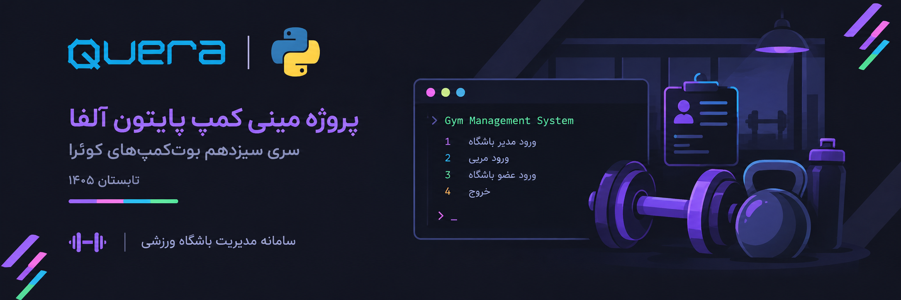
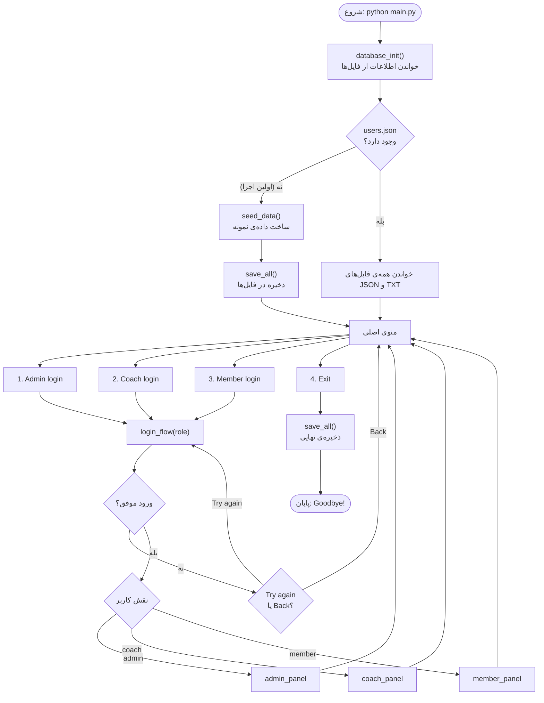
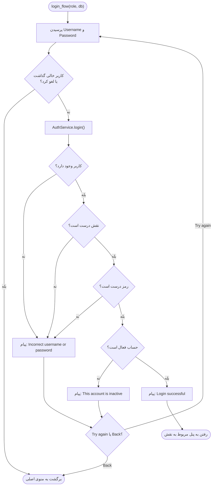
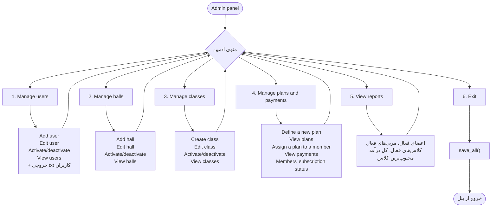
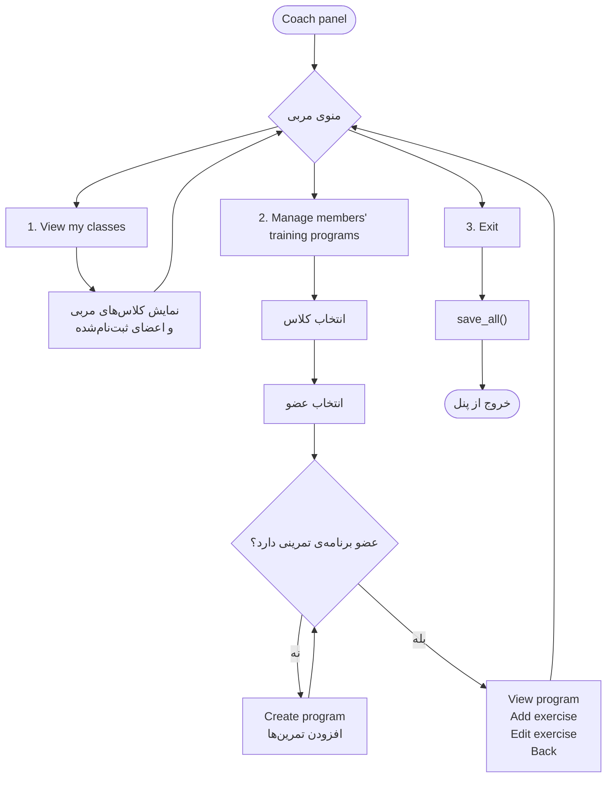
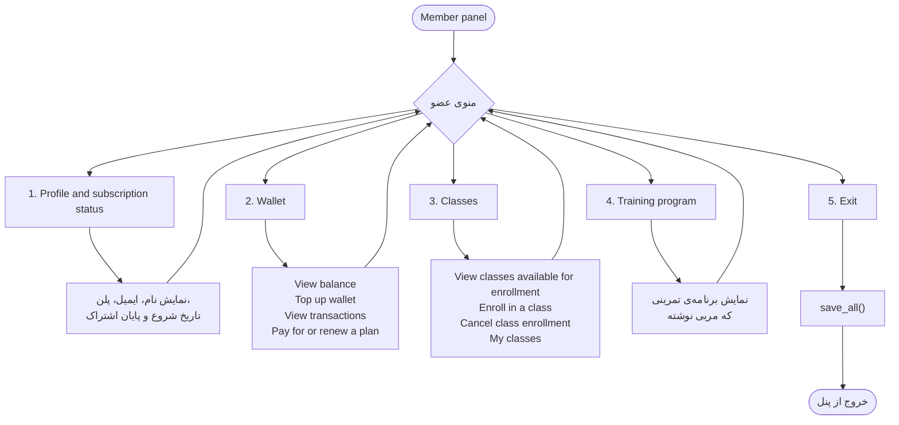
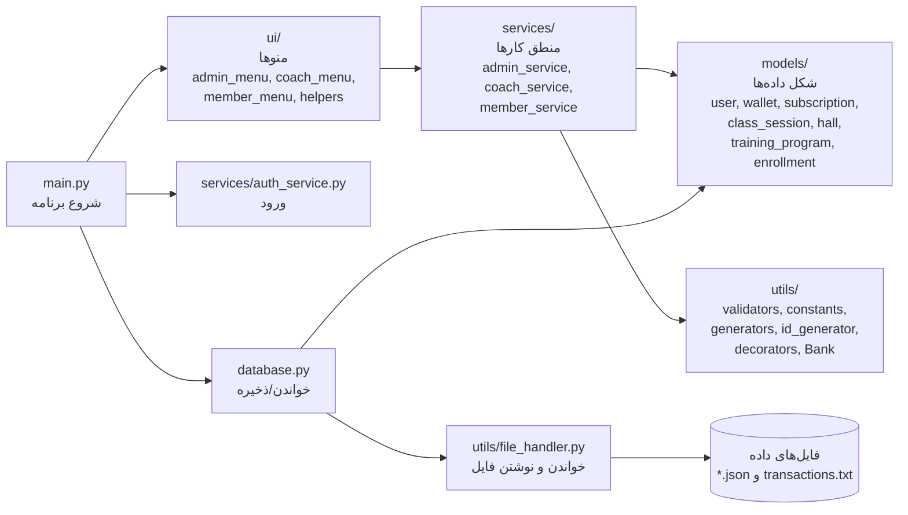
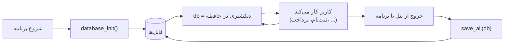

  

---

## ۱. نمای کلی برنامه

---

## ۲. ورود به سیستم (Login)

---

## ۳. پنل ادمین (Admin)

---

## ۴. پنل مربی (Coach)

---

## ۵. پنل عضو (Member)

---

## ۶. ساختار فایل‌ها (چه کسی با چه کسی حرف می‌زند؟)

---

## ۷. مسیر ذخیره‌ی اطلاعات

